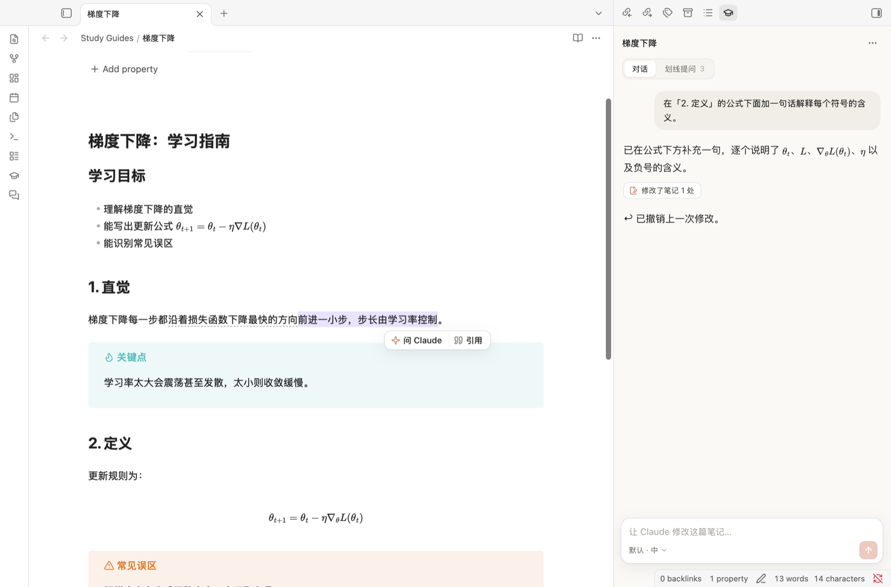
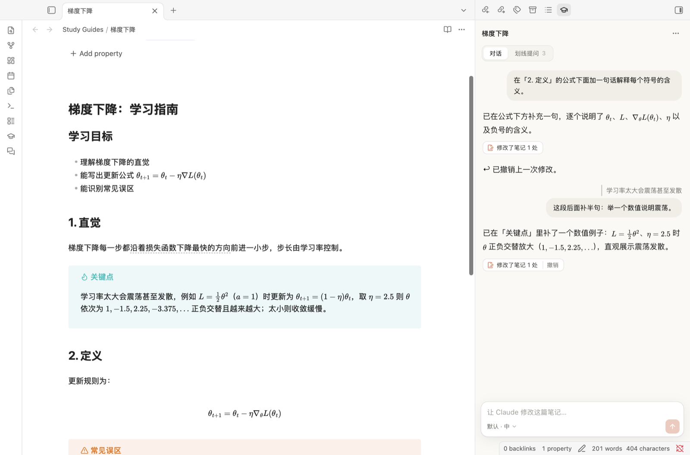

# Study Agent — Claude 学习助手（Obsidian 插件）

用 Claude 生成学习笔记、在侧边栏让 Claude 直接修改笔记，并且可以在笔记里划线、就地提问。问过的地方会留下灰色虚线，点一下就能回到当时的对话。

仅支持 Obsidian 桌面版。插件通过 [Claude Agent SDK](https://code.claude.com/docs/en/agent-sdk/overview) 调用本机的 `claude` 命令行，用的是你自己的 Claude Code 登录。



## 功能

- **新建学习指南**：写一个主题，或者粘贴一段文字、一个链接，也可以用当前打开的笔记或 PDF 作为材料。Claude 会生成一篇循序渐进的 Markdown 笔记：先建立直觉，再给定义和例子，配有 callout、可折叠的自测题和公式，保存在 `Study Guides/`。
- **生成进度**：指南在后台生成，点「生成」后对话框就会关闭。侧边栏的「生成」标签页列出每一篇的状态：正在写（已写多少字、用了多久）、已完成（点击打开）、失败（显示原因，可以重试）、或者因为 Obsidian 被关闭而中断。生成途中可以停止。状态栏也会显示正在生成几篇。
- **划线提问**：在编辑视图或阅读视图里选中文字，点「问 Claude」，会就地打开一个对话卡片。
  - 问过的地方留下灰色虚线，点一下就能重新打开当时的对话，可以继续追问。
  - 对话卡片可以拖动顶部那一条来移动，双击它会贴回原文旁边；右边和下边可以拖动调整大小。位置和尺寸都会被记住。
- **侧边栏主 agent**：对当前笔记说「加一个数值例子」「把我的划线提问整理进正文」，Claude 会直接修改笔记。每次修改都可以撤销。
- **引用**：选中文字后点「引用」，这段会进入侧边栏输入框，可以连续引用好几段，然后说「把这段改得更直观」。agent 会根据引用的原文和上下文找到对应位置。
- **模型和思考力度**：每个输入框里都能切换模型（默认 / Opus 5.5 / Sonnet 5.5 / Haiku 5.5）和思考力度（低 → 最高）。侧边栏、划线提问、新建指南分别记住各自的选择。
- **界面**：参照 Claude App 的设计语言，跟随 Obsidian 的浅色 / 深色主题。



## 安装

需要 Node.js 18+，以及已经登录的 [Claude Code](https://code.claude.com) 命令行。选择 Opus 5.5 / Sonnet 5.5 / Haiku 5.5 需要 Claude Code 2.1.280 或更新的版本；版本太旧时插件会提示，运行 `claude update` 即可。

```bash
git clone git@github.com:dhmbb2/claude_chat_obsidian.git
cd claude_chat_obsidian
npm install
npm run build
```

把构建出的三个文件复制到你的库里：

```bash
mkdir -p "<你的库>/.obsidian/plugins/study-agent"
cp main.js manifest.json styles.css "<你的库>/.obsidian/plugins/study-agent/"
```

然后在 Obsidian 的 设置 → 第三方插件 里启用 **Study Agent**。

### 登录

插件使用本机 Claude Code 的登录（Pro / Max 套餐额度）。第一次使用前，在终端运行：

```bash
claude auth login
```

如果设置了 `ANTHROPIC_API_KEY`，Claude Code 会改用 API 计费。插件会在 `~/.local/bin/claude`、`/opt/homebrew/bin/claude` 等常见位置自动查找 `claude`；找不到时，可以在插件设置里手动填写路径（终端运行 `which claude` 可以查到）。

> **注意**：Anthropic 不允许第三方产品向别人提供 claude.ai 登录或套餐额度。这个插件适合自己在本机使用；如果要分发给别人，应改成让用户使用自己的 API key。

## 使用

| 操作 | 方式 |
|---|---|
| 新建学习指南 | 左侧栏学士帽图标，或命令「新建学习指南」 |
| 打开侧边栏 | 左侧栏对话图标，或命令「打开学习助手侧边栏」 |
| 查看生成进度 | 侧边栏「生成」标签页、状态栏，或命令「查看学习指南的生成进度」 |
| 划线提问 | 选中文字 → 「问 Claude」，或命令「对选中文字提问」 |
| 引用到侧边栏 | 选中文字 → 「引用」，或命令「引用选中文字到学习助手」 |
| 重新打开提问 | 点虚线，或在侧边栏「划线提问」里点对应的卡片 |
| 撤销修改 | 侧边栏里那次修改下方的「撤销」 |

命令都可以在 设置 → 快捷键 里绑定快捷键。

## 数据存放

- 生成的学习指南是普通的 Markdown 笔记。笔记正文里不会写入任何标记。
- 划线提问、侧边栏对话、撤销快照和最近 30 条生成记录存在 `.obsidian/plugins/study-agent/data.json`，按笔记路径区分；笔记重命名或删除时会跟着更新。
- 每次调用都是一个独立的 Claude Code 会话：不加载你的 CLAUDE.md 和设置，也不写入 Claude Code 的会话记录。

## 开发

```bash
npm run build   # 打包成 main.js
npm run check   # TypeScript 类型检查
```

| 文件 | 作用 |
|---|---|
| `src/agent.ts` | 所有 Claude 调用：生成指南（只开放 Read 读 PDF、WebFetch 抓链接）、侧边栏编辑（进程内 MCP 工具 `edit_note` / `rewrite_note`，通过 `vault.process` 修改笔记）、划线问答 |
| `src/main.ts` | 插件入口：设置、命令、选区工具条、虚线标记、提问记录的存取 |
| `src/sidechat.ts` | 划线提问的对话卡片（移动、缩放、问答） |
| `src/view.ts` | 右侧边栏：对话、引用、撤销、划线提问列表 |
| `src/modal.ts` | 新建学习指南对话框 |
| `src/jobs.ts` | 后台生成任务：进度、停止、重试、保存成笔记；重启后把没写完的标成中断 |
| `src/anchors.ts` | 文本锚点：选中的原文加前后各约 40 字的上下文，笔记改动后仍能重新定位 |
| `src/plaintext.ts` | 把 Markdown 投影成接近阅读视图的纯文字（去掉粗体、双链、公式、callout 等标记），让编辑视图和阅读视图共用同一套锚点 |
| `src/editor.ts` | 编辑视图（CodeMirror 6）里的虚线装饰和选区处理 |
| `src/ui.ts` | 共用组件：输入框、模型 / 思考力度选择器、下拉菜单 |
| `shims/events.cjs` | 在 Obsidian 的 Electron 渲染进程里，全局 `AbortController` 是浏览器版本，Node 的 `events.setMaxListeners` 不接受它的 signal；打包时用这个 shim 替换 SDK 对 `events` 的引用 |

## 已知限制

- 仅支持桌面版：移动端没有 Node，无法启动 `claude` 子进程。
- 用 PDF 作为材料生成指南的流程还没有充分测试。
- 中文没有合适的衬线字体时会回退到苹方，所以中文回答显示为无衬线字体。
